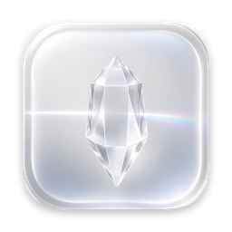
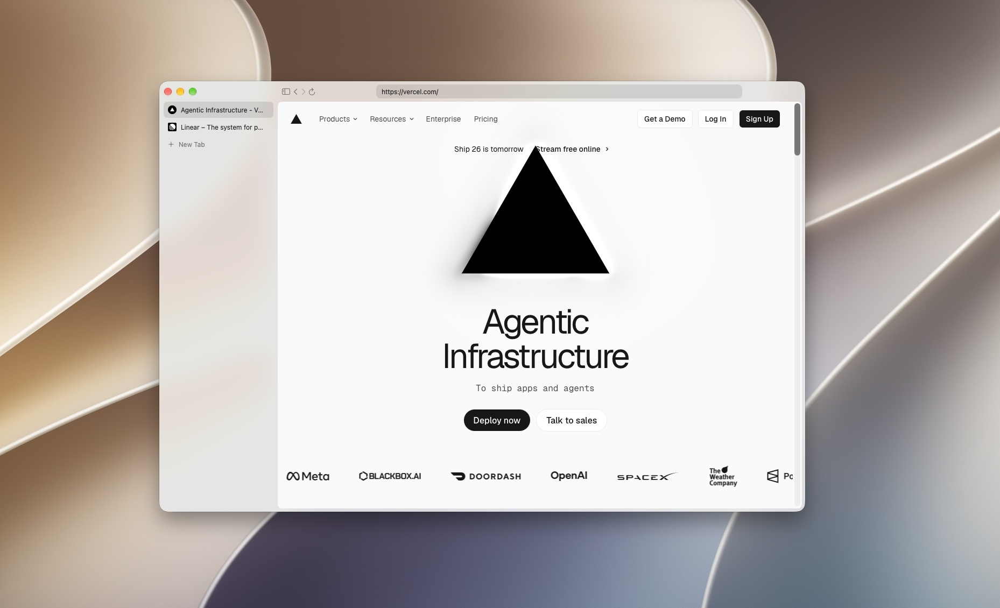
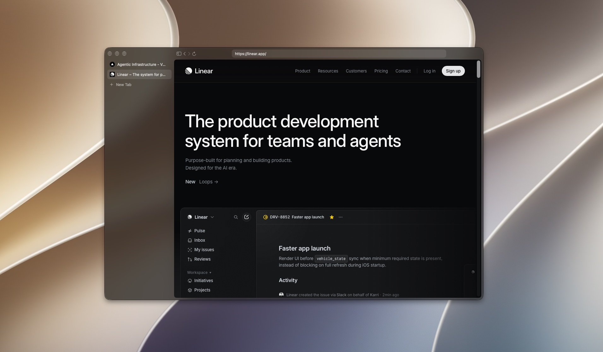

<p align="center"></p>

<h1 align="center">Crystal</h1>
<p align="center">A featherweight, frosted-glass browser for macOS. Native SwiftUI on Apple's WebKit, about 1.6 MB.</p>
<p align="center"><a href="https://github.com/abhidatta-s/crystal/releases/latest"><b>Download the latest release</b></a></p>

<p align="center"> </p>

## Install
1. Download `Crystal-0.1.0-macOS-arm64.zip` from [Releases](https://github.com/abhidatta-s/crystal/releases/latest) and unzip it.
2. Move **Crystal** to your Applications folder.
3. Crystal is free and not notarized, so the first time, right-click it and choose **Open**, then confirm. If macOS still blocks it, go to System Settings > Privacy & Security and click **Open Anyway**.

Requires macOS 14 or later on Apple silicon.

## Build from source

A tiny native macOS browser: SwiftUI + AppKit, the system WebKit engine, and a
frosted-glass window. Vertical tabs in a collapsible sidebar, a slim toolbar,
one WKWebView per tab, and private windows.

## Requirements
- macOS 14 Sonoma or later
- Xcode command line tools (free): `xcode-select --install`

No Xcode project, no packages, no paid tools.

## Build and run
```sh
cd ~/Projects/glass-browser-mac
./build.sh                # compiles, builds the icon, writes Info.plist, ad-hoc signs, prints size
open build/Crystal.app
```
Options: `ARCH=x86_64 ./build.sh` for an Intel Mac; `SWIFT_MODE=6 ./build.sh`
to compile in the Swift 6 language mode (strict concurrency checking).

## Shortcuts
| Keys | Action |
|---|---|
| ⌘T / ⌘W | New tab / close tab (closing the last tab closes the window) |
| ⇧⌘T | Reopen closed tab |
| ⌘N / ⇧⌘N | New window / new private window |
| ⇧⌘W | Close window |
| ⌘L | Focus the address bar (Esc reverts) |
| ⌘R | Reload |
| ⌘[ / ⌘] | Back / forward (two-finger swipe works too) |
| ⌘S | Toggle sidebar |
| ⌃Tab / ⌃⇧Tab | Next / previous tab |
| ⌘1…⌘8, ⌘9 | Select tab 1–8, last tab |

⌘-click or middle-click a link opens it in a background tab (add ⇧ to switch to
it). `target=_blank` links open in a background tab; script-opened windows open
in front.

Private windows use an in-memory website data store (nothing is written to
disk), show a "Private" badge, and are not restored after relaunch.

## Layout
```
build.sh                     swiftc build -> build/Crystal.app (icon via sips + iconutil)
Resources/AppIcon-1024.png   icon master (transparent, Apple icon grid)
tools/make-icon.py           regenerates the icon master from the tile render (Pillow + numpy)
Sources/Crystal/
  CrystalApp.swift           @main, normal + private window scenes, Ctrl-Tab key monitor
  Commands.swift             menu bar commands and shortcuts
  BrowserWindowModel.swift   per-window tabs, active tab, data store, closed-tab stack
  Tab.swift                  one tab: WKWebView, state, favicon, WebKit delegates, URL/search logic
  ContentView.swift          sidebar + toolbar + web view layout
  SidebarView.swift          tab list (favicon, title, hover close, active highlight), New Tab
  ToolbarView.swift          back / forward / reload / address field / progress / Private badge
  WebView.swift              NSViewRepresentable hosting the active tab's web view
  Glass.swift                glass background, window setup, traffic-light centring, drag areas
```
